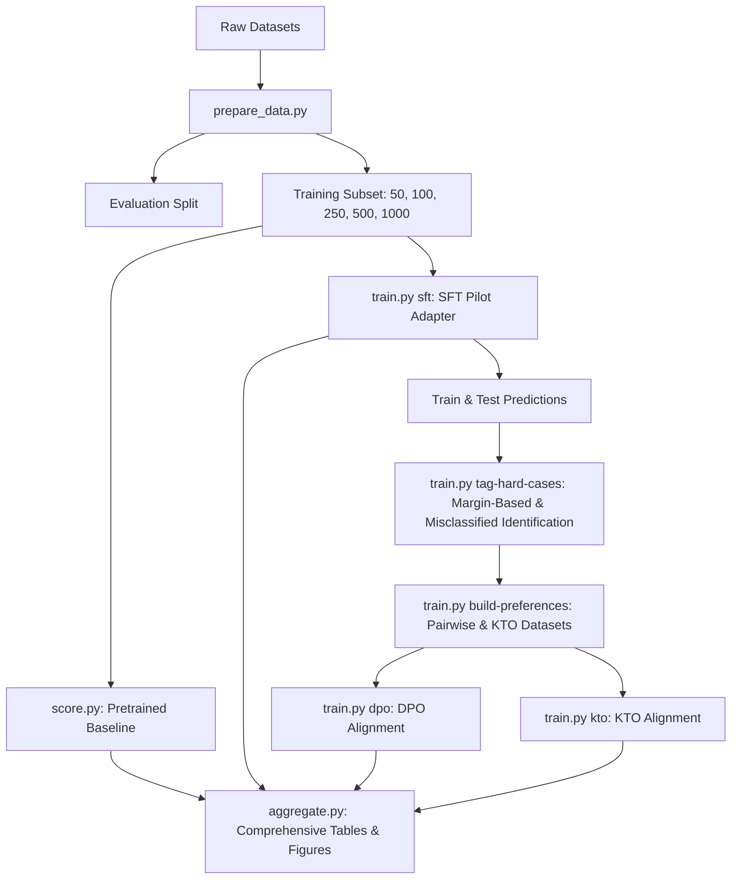

# Beyond Supervised Fine-Tuning
> **Evaluating Preference-Based Post-Training Methods for Political Text Annotation with Large Language Models**

---

[](#)
[](#)
[](#)
[](#)

This repository provides a complete pipeline designed to systematically evaluate and compare **Supervised Fine-Tuning (SFT)** against **Preference Alignment (PA)** methods—specifically **Direct Preference Optimization (DPO)** and **Kahneman–Tversky Optimization (KTO)**—for complex, low-data political text classification tasks. 

## Quickstart & Pipeline Invocations

Run notebooks '/main_colab_train+infer_three_seeds.ipynb notebooks'

## ABSTRACT

The complexity and inherent ambiguity of political text annotation tasks present a persistent challenge in social science research, particularly in low-data regimes where expert labels are scarce. While Supervised Fine-Tuning (SFT) is the prevailing post-training paradigm for Large Language Models (LLMs), the efficacy of Preference Alignment (PA) methods remains largely unexplored in this domain. This study addresses the critical question of whether PA strategies, such as Direct Preference Optimization (DPO) and Kahneman–Tversky Optimization (KTO), enhance classification performance over SFT alone in complex political text classification. Replicating a prior experimental design across three low-data political annotation tasks, we systematically compare SFT against standalone and sequential PA configurations using the Llama 3.1:8B and Gemma 3:12B models, employing a log-probability-based classification method. Our findings demonstrate that the sequential application of SFT followed by a PA method can improve performance in several data regimes, yielding F1-score improvements up to 8.2% compared to SFT alone. Conversely, standalone PA methods show generally a performance degradation. Specifically, the combined SFT+DPO configuration using a novel, model-based hard-negative preference construction strategy exhibits superior efficacy in most settings. This research provides practical guidelines and epistemological reflexivity for implementing PA in social science workflows, underscores the enhanced performance of smaller, fine-tuned models over proprietary baselines, and reinforces the conclusion that researchers must deliberately select a post-training strategy tailored to the specific conceptual and data constraints of their annotation task.

> [!WARNING]
> **Colab / Jupyter PyArrow Precaution:**  
> When running the interactive training notebooks on Google Colab a crash will occur during the PyArrow data tokenization stage. This is a known issue. If the runtime terminates or crashes, simply **restart the Python runtime/kernel** and proceed; your progress is saved on disk.

---

## 🗺️ Pipeline & Orchestration Architecture



The workflow executes in a modular, highly reproducible sequence:
1. **Data Preprocessing (`prepare_data.py`)**: Stratifies datasets and generates standardized train-size subsets.
2. **Pretrained Baseline (`score.py`)**: Runs zero-shot/few-shot evaluations on the base model using candidate log-probability scoring.
3. **SFT Pilot Training (`train.py sft`)**: Trains a supervised adapter on the training subset using LoRA.
4. **Hard Case Tagging (`train.py tag-hard-cases`)**: Scores the dataset and tags low-confidence (margin-based) and misclassified examples.
5. **Preference Dataset Construction (`train.py build-preferences`)**: Generates pairwise DPO rows (`chosen` vs. `rejected`) and binary KTO rows (`desirable` vs. `undesirable`).
6. **Preference Alignment (`train.py dpo` / `kto`)**: Optimizes the model starting from the base model or the SFT pilot adapter.
7. **Aggregation & Reporting (`aggregate.py`)**: Generates comparative leaderboards, per-class breakdowns, training curves, and confusion matrices.

---

## 📊 Supported Tasks & Data Registry

The pipeline supports three low-performance, high-ambiguity annotation tasks derived from the computational social science study of Alizadeh et al. (2025). The settings are loaded dynamically using the registries configured in the canonical study files `configs/llama31.yaml` and `configs/gemma3.yaml`.

| Task ID | Dataset Source | Target Concept | Admissible Classes | Eval Size | Training Regimes |
| :--- | :--- | :--- | :--- | :---: | :---: |
| **`ds1_task6`** | Tweets (2020-2021) | Content Moderation Superframes | **A**: Policy, **B**: Morality/Law, **C**: Economics, **D**: Other | 843 | `[50, 100, 250, 500]` |
| **`ds3_task6`** | Congress Tweets (2017-22) | Political Superframes | **A**: Policy, **B**: Morality/Law, **C**: Economics, **D**: Other | 341 | `[50, 100, 250, 500]` |
| **`ds4_task2`** | News Articles | Problem / Solution / Neutral | **A**: Problem, **B**: Solution, **C**: Neutral | 196 | `[50, 100, 250, 500, 1000]` |

---

## 🧪 Alignment Strategies & Data Allocation

### 1. DPO Preference Construction Strategies
Unlike generative DPO, this repository frames preference alignment strictly over **closed-label choices** using two rejected-label sampling strategies:
*   **`random_wrong`**: Samples the dispreferred/rejected response uniformly at random from the set of incorrect labels.
*   **`hard_negative`**: Uses the SFT pilot adapter to score all incorrect label completions. The highest-scoring wrong completion is chosen as the rejected response, forcing the DPO loss to focus on the model's most competitive/plausible errors.

### 2. KTO Dataset Construction
KTO evaluates binary desirability rather than pairwise comparisons. The pipeline structures KTO as an all-label dataset:
*   **1 Desirable Row**: `Prompt` + Gold JSON label completion (`label = True`).
*   **K-1 Undesirable Rows**: `Prompt` + each incorrect JSON label completion (`label = False`).

### 3. Data Allocation Regimes
The pipeline supports two allocation regimes:
*   **`shared`**: SFT and the preference optimization step both train on the full selected subset.
*   **`sft25_dpo75`**: SFT is trained on a stratified 25% split of the training subset. The SFT pilot then generates hard negatives and builds preferences strictly on the remaining 75% of the subset, isolating the alignment step from SFT training rows.

---

## 📁 Repository Structure

```directory
DPO-main/
├── configs/
│   ├── llama31.yaml              # Hyperparameters & settings for Llama 3.1 8B Instruct
│   └── gemma3.yaml               # Hyperparameters & settings for Gemma 3 12B IT
├── data/
│   └── raw_or_samples/           # Source CSVs & local registries partitioned by task ID
├── Results_data_figures/         # Aggregated experimental outputs, figures, and baselines
│   ├── Code_for__figures.ipynb   # Jupyter notebook for generating all paper figures & tables
│   ├── Result value accuracy Alizadeh et al.xlsx # Excel baseline values
│   └── merged_tasks_*.png        # Rendered paper figures
├── scripts/
│   ├── prepare_data.py           # Preprocessing and train-subset generation
│   ├── score.py                  # Pretrained baseline evaluation script
│   ├── train.py                  # CLI orchestrator for SFT, DPO, KTO, and full pipelines
│   └── aggregate.py              # Aggregation & plot rendering script
├── src/
│   └── topic_alignment/          # Core python package modules
│       ├── config.py             # Config schema loading & parameter overrides
│       ├── data.py               # Allocation and processing functions
│       ├── evaluation.py         # Macro-F1 and Accuracy calculators
│       ├── inference.py          # Logprob calculation & prediction writers
│       ├── modeling.py           # PEFT and adapter loaders (via Unsloth)
│       ├── prompting.py          # Prompt schemas & KTO/DPO row formatters
│       ├── reporting.py          # Report builders and matplotlib visualizers
│       └── training.py           # TRL train wrappers (SFTTrainer, DPOTrainer, KTOTrainer)
├── notebooks/
│   └── main_colab_train+infer_three_seeds.ipynb  # Interactive orchestration notebook
├── dataset_task_mappings.csv     # Central dataset registry metadata
├── pyproject.toml                # Package structure definitions
└── requirements.txt              # Pipeline dependencies
```

---

---

## 📈 Evaluation & Candidate Log-Probability Scoring

To bypass the stochasticity and formatting failures of auto-regressive generation, predictions are scored using a **closed-label candidate log-probability scoring** method:
1. Admissible class labels are structured as short, canonical JSON completions (e.g., `{"label":"A"}`, `{"label":"B"}`).
2. The pipeline calculates the exact conditional log-probability assigned by the model to each candidate completion.
3. Class scores are normalized across candidates:
   $$P(\text{Class } c) = \frac{\exp(\log P(c))}{\sum_{i} \exp(\log P(i))}$$
4. The predicted class corresponds to the candidate obtaining the highest score. Score margins between the top two classes serve as a robust measure of model uncertainty.

---
